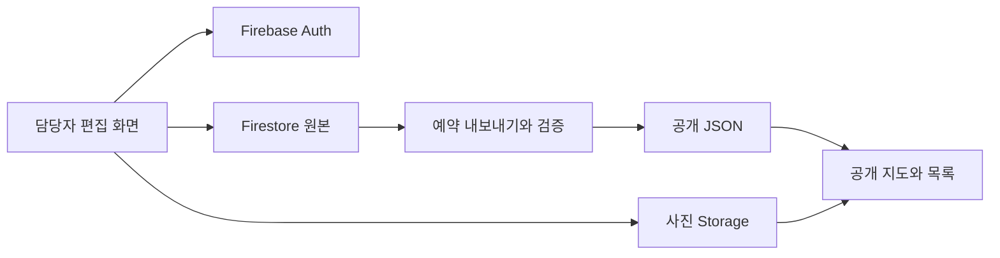

# 우리동네 현안도, 이세미입니다

판교·운중·백현·대장 지역의 현안과 변화를 지도와 목록으로 보여주는 정적 웹앱입니다. 공개 열람은 JSON 스냅샷으로 제공하고, 담당자 편집은 Firebase 인증과 Firestore로 분리했습니다.

## 해결하려는 문제

지역 현안은 위치, 분야, 진행 상태를 함께 확인해야 맥락을 이해하기 쉽습니다. 이 프로젝트는 동별·분야별 통계, 지도 마커, 상세 설명과 사진을 연결해 같은 정보를 여러 경로로 탐색하도록 구성했습니다. 담당자는 별도 편집 화면에서 내용을 관리합니다.

## 주요 기능

- 현안·변화·안내 탭과 동별·분야별·상태별 필터
- OpenLayers 지도, 행정동 경계, 목록과 연결된 마커·팝업
- 진행 상태 표시, 상세 모달, 항목 공유 링크
- 사진 슬라이드·확대 보기와 이미지 로딩 상태 처리
- Google 로그인과 `staff` 커스텀 클레임을 사용하는 관리자 편집 화면
- Firestore 원본에서 공개 JSON을 내보내고 형식을 검사하는 스크립트

UI와 데이터 처리는 [app.js](app.js), 화면별 동작과 테스트 연결은 [사용자 시나리오](docs/user-scenarios.md)에서 확인할 수 있습니다.

## 실제 화면과 데모

- [공개 현안 지도](https://leesemi-camp.github.io/): 탭·통계·목록에서 항목을 선택해 지도와 상세 내용을 확인합니다.
- [편집 화면](https://leesemi-camp.github.io/edit/): Firebase 로그인과 담당자 권한이 필요합니다.
- [내부 서비스 런처](https://leesemi-camp.github.io/system/): 권한 확인 후 등록된 서비스로 이동합니다.

2026-11-13 공개 지도 렌더링과 편집 화면의 HTTP 응답을 확인했습니다. 관리자 로그인·운영 데이터 수정은 이 확인에 포함하지 않았습니다. 과거 `/map/`, `/map/edit/` 주소는 각각 `/`, `/edit/`로 이동합니다.

## 기술 스택

| 영역 | 사용 기술 |
|---|---|
| 화면 | HTML, CSS, JavaScript ES modules |
| 지도 | OpenLayers 10.8, OSM Korea 타일, GeoJSON·WFS XML |
| 관리자 인증·저장 | Firebase Auth, Firestore, Firebase Storage |
| 검증 | Playwright, Monocart, JSON 검사 스크립트 |
| 실행·배포 | Node.js 20 이상, GitHub Pages, GitHub Actions |

## 구조와 주요 설계



**공개 열람과 원본 편집을 분리했습니다.** [공개 페이지](index.html)는 Firebase SDK를 초기화하지 않고 [JSON 스냅샷](data/hotspots.public.json)을 읽습니다. [편집 페이지](edit/index.html)는 인증 후 원본을 구독합니다. 이 구조로 공개 열람 요청이 Firestore 직접 읽기로 이어지는 것을 피합니다. 성능이나 비용 절감률을 측정한 수치는 없습니다.

**공개 데이터에 포함할 필드를 선택합니다.** [내보내기 스크립트](scripts/export-hotspots-public-json.mjs)는 공개 필드를 선정하며, [검사 스크립트](scripts/validate-hotspots-public-json.mjs)는 작성자 필드·인라인 사진 데이터 등 금지 항목과 좌표·분류를 검사합니다. 사진은 JSON에 base64로 넣지 않고 URL로 참조합니다.

**권한을 화면과 저장소에서 확인합니다.** 편집 진입 시 로그인과 `staff`를 확인하고, [Firestore 규칙](firestore.rules)과 [Storage 규칙](storage.rules)에서 접근을 제어합니다. 규칙 파일은 실제 Firebase 프로젝트에도 적용해야 합니다.

**데이터 갱신과 사이트 배포를 나눴습니다.** [Export Public Hotspots](.github/workflows/export-hotspots.yml)는 설정상 일 1회(`0 9 * * *`, UTC 09:00/KST 18:00)와 수동 실행을 지원합니다. 변경된 JSON을 커밋하면 [Pages 배포](.github/workflows/deploy-pages.yml)가 실행됩니다. 예약 실행은 지연될 수 있으며 편집 내용이 공개 화면에 즉시 반영되는 구조는 아닙니다.

## 설치와 실행

공개 화면은 저장된 JSON으로 실행할 수 있습니다. 지도 타일·CDN·사진을 불러오려면 인터넷 연결이 필요합니다.

```bash
git clone https://github.com/leesemi-camp/leesemi-camp.github.io.git
cd leesemi-camp.github.io
npm ci
npm run serve
```

`http://127.0.0.1:5173/`에서 공개 지도, `/edit/`에서 편집 화면을 엽니다. [정적 서버](scripts/serve-static.mjs)의 기본 포트는 5173입니다.

독립된 편집 환경을 구성하려면 다음 설정이 필요합니다.

1. 본인 Firebase 프로젝트에서 Google 로그인, Firestore, Storage를 준비합니다.
2. [config.example.js](config.example.js)를 참고해 [config.js](config.js)를 본인 환경에 맞추고 `localhost` 등 로그인 도메인을 등록합니다.
3. `firestore.rules`, `storage.rules`를 프로젝트에 적용하고 담당자 계정에 `staff=true` 클레임을 부여합니다. [권한 부여 스크립트](scripts/set-staff-claim.cjs)는 별도 `firebase-admin` 설치가 필요합니다.
4. 자동 내보내기를 사용하려면 저장소 Secret `FIREBASE_SERVICE_ACCOUNT_JSON`을 설정합니다. 수동 내보내기 옵션은 해당 스크립트를 확인합니다.

`config.js`는 브라우저에 공개됩니다. 서비스 계정 JSON과 외부 API 비밀 토큰을 넣지 마세요. 공개 저장소의 기존 설정으로 운영 데이터를 수정하지 말고 별도 프로젝트를 사용하세요. 자세한 절차는 [시작 가이드](docs/getting-started.md)에 있습니다.

## 테스트와 검증

```bash
npm run validate:hotspots
npx playwright install chromium chrome msedge webkit
npm test
```

[Playwright 설정](playwright.config.js)은 Chromium, Chrome, Edge, WebKit 프로젝트와 로컬 정적 서버를 사용합니다. [tests/](tests/)에는 지도·목록·팝업·사진·포커스·오프라인 처리 등의 테스트가 있습니다. `npm run test:coverage`는 Chromium 커버리지 프로젝트를 실행합니다.

[CI](.github/workflows/ci.yml)는 브라우저 테스트와 Firestore 내보내기 검사를 수행합니다. 내보내기 job에는 저장소 Secret이 필요합니다. 2026-11-13 문서 점검에서는 공개 스냅샷 검사를 통과했으며, 전체 E2E와 실제 관리자 편집은 다시 실행하지 않았습니다. 같은 날 [README PR의 CI](https://github.com/leesemi-camp/leesemi-camp.github.io/actions/runs/43356566948)에서는 스냅샷 job이 통과했지만, 브라우저 job은 Ubuntu 26.04에서 Playwright 1.58.2의 브라우저 의존성 설치가 지원되지 않아 테스트 실행 전에 실패했습니다.

## 현재 상태와 알려진 한계

- 공개 지도와 관리자 편집 경로가 구현되어 있습니다. 공개 데이터의 최신성은 내보내기·배포 성공 여부에 따라 달라집니다.
- 교통 오버레이·생활이동 데이터 처리 코드는 있지만, 교통 API URL은 현재 비어 있습니다. 샘플 데이터와 실제 운영 연동을 구분해야 합니다. 설정은 [외부 API 안내](docs/external-api.md)를 참고하세요.
- 외부 현안 카탈로그 연동은 기본 비활성이고 Firebase App Check도 기본 비활성입니다.
- `/party-dialer/`, `/sponsor-dialer/`는 준비 화면입니다. 런처의 외부 전화 시스템·글 작성 도우미는 이 저장소의 구현 범위에 포함하지 않습니다.
- 주요 로직이 `app.js`에 모여 있습니다. 자동 테스트가 실제 Firebase 로그인·운영 권한·모든 사용자 시나리오를 검증하는 것은 아닙니다.
- 외부 타일·CDN·Firebase 서비스와 네트워크에 의존합니다.

## 관련 문서

- [서비스 개요](docs/project-brief.md)
- [사용자 시나리오와 검증 공백](docs/user-scenarios.md)
- [데이터 파일과 원본 구조](docs/data-hotspots-and-routes.md)
- [예산 알림·비용 보호 구성](docs/cost-guard-telegram.md)

지도 데이터의 출처는 OpenStreetMap contributors, 타일 제공은 OpenStreetMap Korea입니다. 화면의 출처 표기를 유지해야 합니다.
